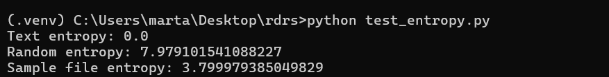
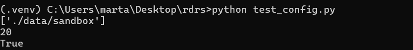
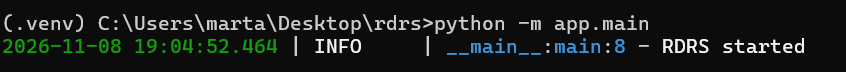

# RDRS — Ransomware Detection and Response System

RDRS is a defensive Python project that monitors folders for ransomware-like
file activity. It calculates file entropy, records events, and will later
generate alerts, incidents, reports, and a dashboard.

This project is for educational and defensive-security purposes only.
It does not create, download, or execute malware.

## Phase 1 completed

- Created the project structure
- Created and activated a Python virtual environment
- Installed required Python libraries
- Created `requirements.txt`
- Implemented Shannon entropy calculation
- Created a YAML configuration loader using Pydantic
- Added rotating log files using Loguru
- Tested entropy calculation and configuration loading

## Project structure

```text
rdrs/
├── app/
│   ├── __init__.py
│   ├── main.py
│   ├── core/
│   │   ├── __init__.py
│   │   ├── config.py
│   │   ├── entropy.py
│   │   └── logging_setup.py
├── tests/
├── logs/
├── data/
├── config.yaml
├── requirements.txt
└── README.md
```

## How to run

1. Install Python 3.12 or newer.
2. Create and activate a virtual environment:

```bash
python -m venv .venv
.venv\Scripts\activate
```

3. Install dependencies:

```bash
pip install -r requirements.txt
```

4. Run the program:

```bash
python -m app.main
```

## Current status

Phase 1 is complete. The next phase will add real-time file monitoring using
the `watchdog` library.

## Phase 1 verification

### Entropy test
The test compares entropy for repeated bytes, random bytes, and a sample text file.



### Configuration test
The test loads settings from config.yaml and prints selected values.



### Program startup
The application starts and writes a startup log message.



## Phase 2: Real-time file monitoring

RDRS monitors the configured sandbox folder and records file creation, modification, renaming, and deletion events.

 
