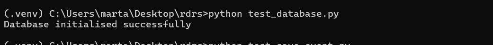
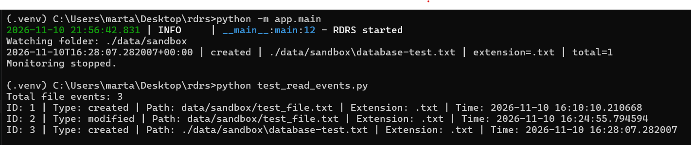
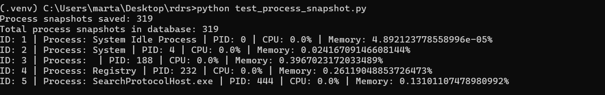
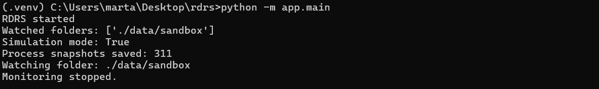
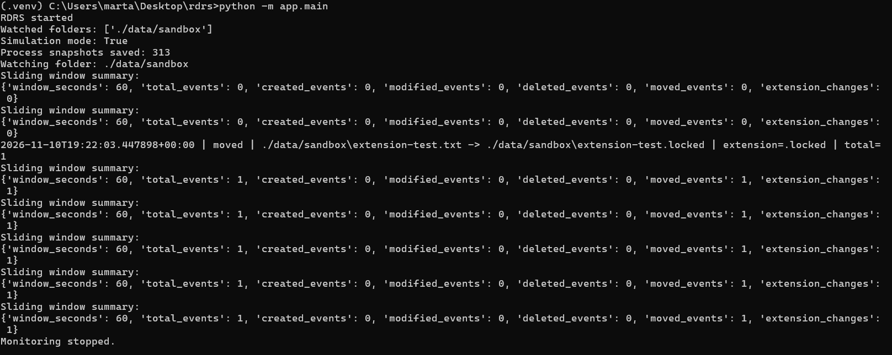
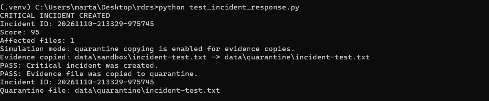
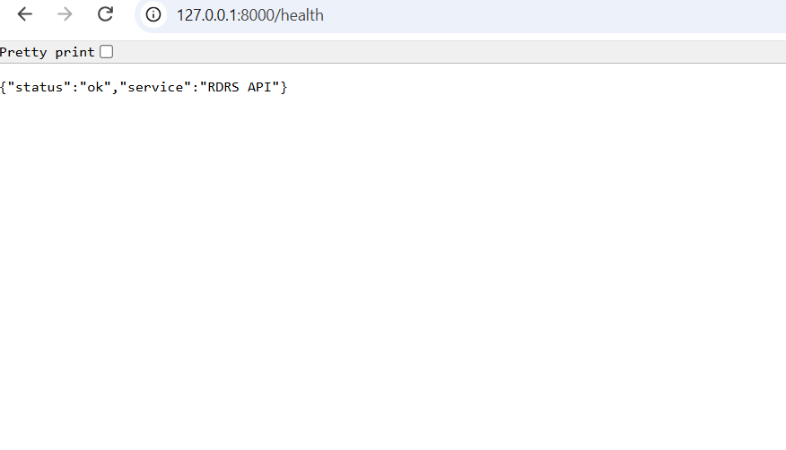
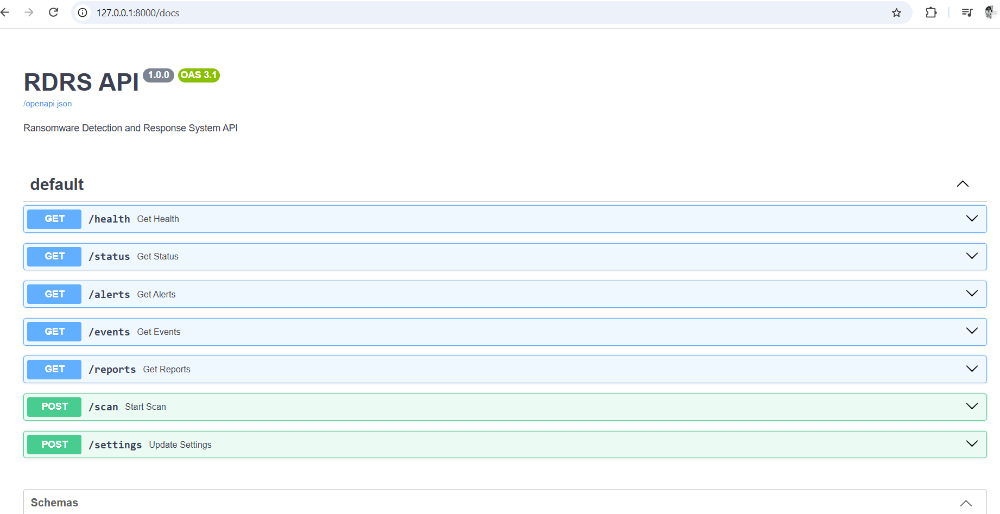

# RDRS — Ransomware Detection and Response System

RDRS is a defensive Python project that monitors folders for ransomware-like
file activity. It calculates file entropy, records events, and will later
generate alerts, incidents, reports, and a dashboard.

This project is for educational and defensive-security purposes only.
It does not create, download, or execute malware.

## Phase 1 completed

- Created the project structure
- Created and activated a Python virtual environment
- Installed required Python libraries
- Created `requirements.txt`
- Implemented Shannon entropy calculation
- Created a YAML configuration loader using Pydantic
- Added rotating log files using Loguru
- Tested entropy calculation and configuration loading

## Project structure

```text
rdrs/
├── app/
│   ├── __init__.py
│   ├── main.py
│   ├── core/
│   │   ├── __init__.py
│   │   ├── config.py
│   │   ├── entropy.py
│   │   └── logging_setup.py
├── tests/
├── logs/
├── data/
├── config.yaml
├── requirements.txt
└── README.md
```

## How to run

1. Install Python 3.12 or newer.
2. Create and activate a virtual environment:

```bash
python -m venv .venv
.venv\Scripts\activate
```

3. Install dependencies:

```bash
pip install -r requirements.txt
```

4. Run the program:

```bash
python -m app.main
```

## Current status

Phase 1 is complete. The next phase will add real-time file monitoring using
the `watchdog` library.

## Phase 2: Real-Time File Monitoring

RDRS can monitor configured folders in real time.

### Monitoring features

- Detects file creation.
- Detects file modification.
- Detects file deletion.
- Detects file renaming and movement.
- Displays live event messages in the terminal.
- Counts the total number of detected events.

### Files added

```text
app/core/events.py
app/detectors/file_monitor.py
```

### Phase 2 screenshot


## Phase 3: SQLite Database and Process Snapshots

RDRS now stores file events and process snapshots in an SQLite database.

### Database features

- Stores detected file events in the `file_events` table.
- Stores process snapshots in the `process_snapshots` table.
- Saves process information when RDRS starts.
- Uses SQLAlchemy and SQLite.
- Uses `psutil` to collect process information.

### Files added

```text
app/database/models.py
app/database/database.py
app/database/event_repository.py
app/database/process_repository.py
```

### Phase 3 screenshots








## Phase 4: Sliding-Window Detection

RDRS now analyses file activity over the last 60 seconds.

### Detection features

- Stores recent file events in a sliding window.
- Removes events older than 60 seconds.
- Counts created, modified, deleted, and moved events.
- Detects file extension changes.
- Displays a sliding-window summary every 10 seconds.
- Prepares activity data for risk scoring in the next phase.

### Files added or updated

```text
app/detectors/window_detector.py
app/detectors/file_monitor.py
test_window_detector.py
```

### Phase 4 screenshot



## Phase 5: Incident Response

Phase 5 adds a basic incident-response workflow for Critical risk events.

When the risk score reaches Critical, RDRS:

- Creates an incident record
- Writes an entry to `logs/alerts.log`
- Copies affected files into `data/quarantine`
- Writes an entry to `logs/audit.log`
- Leaves the original files unchanged

The response is designed to preserve evidence safely. It does not delete, encrypt, or modify original files.

### Files added

- `app/detectors/incident_response.py`
- `test_incident_response.py`
- `test_incident_logs.py`

### Test results

The incident-response test confirmed that:

- A Critical incident can be created
- An affected file can be copied to quarantine
- The alert log is created
- The audit log is created
- The original file remains unchanged

### Screenshots




## Phase 6: FastAPI Backend

Phase 6 adds a FastAPI backend for RDRS.

### API endpoints

- `GET /health`: Checks that the API is running.
- `GET /status`: Returns monitoring and simulation status.
- `GET /alerts`: Returns alert-log entries.
- `GET /events`: Returns the latest 50 file events from SQLite.
- `GET /reports`: Returns a summary of recent file events.
- `POST /scan`: Accepts a scan request without modifying files.
- `POST /settings`: Accepts safe settings without changing configuration.

### API documentation

FastAPI automatically provides documentation at:

```text
http://127.0.0.1:8000/docs
```

### Safety

The `/scan` and `/settings` endpoints only receive requests and return responses. They do not delete, encrypt, or modify files.

### Screenshots





## Phase 7: Dark Dashboard

Phase 7 adds a dark-themed web dashboard for RDRS.

The dashboard is stored in `frontend/index.html`.

It includes four cards:

- System Status
- Alerts
- File Events
- Reports

The dashboard connects to the RDRS API and displays:

- API status
- Monitoring status
- Simulation mode
- Alert records
- Recent file events
- Report summaries

CORS support was added to the FastAPI application so the dashboard can communicate with the API.

### Dashboard screenshot


## Phase 8: Reports

Phase 8 adds report generation to RDRS.

Created `app/reports/report_generator.py`.

The report generator creates a text report in the `data/reports` folder.

Each report includes:

- Total events
- Created events
- Modified events
- Deleted events
- Moved events
- Total alerts

Added a `/generate-report` API endpoint.

The endpoint reads real file-event data from the SQLite database and saves a report file.

Added a **Generate Report** button to the dashboard.

The dashboard can generate a report through the API and display the report path.

### Report screenshot


## Testing

RDRS includes automated tests for configuration, entropy calculation, database storage, API endpoints, report generation, detection logic, risk scoring, and incident response.

Run the complete test suite:

```cmd
python -m pytest --cov=app --cov-report=term-missing
```

Current result:

```text
87 passed
Overall coverage: 89%
```

Coverage highlights:

- `app/api/routes.py`: 100%
- `app/core/config.py`: 100%
- `app/core/entropy.py`: 100%
- `app/core/events.py`: 100%
- `app/core/logging_setup.py`: 100%
- `app/database/*`: 100%
- `app/detectors/risk_scorer.py`: 100%
- `app/detectors/window_detector.py`: 100%
- `app/detectors/incident_response.py`: 98%
- `app/main.py`: 95%
- `app/detectors/file_monitor.py`: 30%

The file monitor has lower coverage because its main function continuously watches the filesystem. Its event-handling behavior is exercised during live testing, while the remaining detection and response logic is covered by automated tests.

To create an HTML coverage report:

```cmd
python -m pytest --cov=app --cov-report=html
```

Open:

```text
htmlcov/index.html
```

## Test Files

- `test_config.py`: original configuration tests
- `test_entropy.py`: original entropy tests
- `test_core.py`: expanded configuration and entropy tests
- `test_database.py`: original database smoke test
- `test_database_isolated.py`: isolated database, event, and process repository tests
- `test_api.py`: API endpoint tests
- `test_startup.py`: startup, shutdown, report-generation, and model tests
- `test_incident_response.py`: incident response tests
- `test_risk_scorer.py`: weighted risk scoring tests
- `test_window_detector.py`: sliding-window detection tests
- `test_detection_pipeline.py`: detection pipeline integration tests

- 
